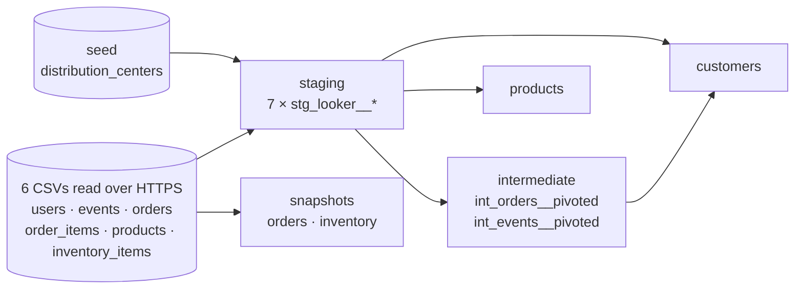

# E-commerce data models with dbt

[](https://github.com/nightraven4545/dbt-ecommerce-data-models/actions/workflows/ci.yml)

This project turns raw e-commerce exports into tested, documented **customer** and **product** tables. Together they answer three questions: who buys, how they found us, and what actually makes money.

It is built with dbt-core 1.12 on DuckDB, needs no warehouse or credentials, and runs with one command. CI rebuilds the project and runs every test on each pull request and each push to `main`; pushes to `main` also republish the data catalog.

**[Read the case study →](https://dbt-ecommerce-data-models.vercel.app/)** · [Browse the live data catalog and lineage graph](https://nightraven4545.github.io/dbt-ecommerce-data-models/)

## What it answers

**Which categories make the most profit?** (from `products`)

| Category | Sales (USD) | Profit (USD) | Margin |
|---|---:|---:|---:|
| Intimates | 157,040 | 73,861 | 47.0% |
| Underwear | 124,546 | 66,009 | 53.0% |
| Sleep & Lounge | 119,388 | 61,927 | 51.9% |
| Tops & Tees | 137,780 | 60,583 | 44.0% |
| Accessories | 94,024 | 56,295 | 59.9% |

Across all 29,120 products, the margin is **50.7%**: $789k profit on $1.56M of sales.

**Where do customers come from, and does the channel matter?** (from `customers`)

| Channel | Customers | Share | With a completed order |
|---|---:|---:|---:|
| Search | 34,981 | 70.0% | 27.5% |
| Organic | 7,619 | 15.2% | 27.2% |
| Facebook | 2,885 | 5.8% | 27.8% |
| Email | 2,497 | 5.0% | 26.8% |
| Display | 2,017 | 4.0% | 27.5% |

Search brings in 70% of customers. Conversion is flat across channels, so the channel mix decides how many customers arrive, not how good they are.

## How it works



| Layer | Built as | What it does |
|---|---|---|
| `staging` | tables | One clean model per raw table: explicit columns, light type fixes, documented, tested. |
| `intermediate` | ephemeral | Jinja loops that pivot order statuses and web sessions into one row per customer. |
| `marts` | tables | `customers` and `products`: wide, business-ready tables for BI. |
| `snapshots` | tables | History of order-status and inventory changes. |

There is no load step. dbt-duckdb reads each CSV directly from its URL during `dbt build`.

## Quickstart

You need Python 3.10 or newer and an internet connection.

```bash
python -m venv .venv
source .venv/bin/activate          # Windows: .venv\Scripts\activate
pip install -r requirements.txt
dbt build                          # seed, models, snapshots, 47 data tests, 1 unit test
dbt docs generate && dbt docs serve
```

Use `dbt build` rather than `dbt test`. The unit test needs the staging tables to exist, and `build` creates them in the right order.

## Data quality

- **47 data tests** cover:
  - unique, non-null keys on every staging model and mart
  - allowed values on marketing channels
  - mart-to-staging relationships
  - non-null money columns, including product cost at the source, so a missing cost can't silently become zero COGS
- **1 unit test** pins the profit logic with hand-made inputs. It fails if anyone reintroduces the bug described below.
- **CI** (GitHub Actions) runs the full build on every pull request and every push to `main`. Pushes to `main` also publish the docs site to GitHub Pages.

## Engineering notes: what I changed from the course

This project started as DataCamp's [Case Study: Building E-Commerce Data Models with dbt](https://www.datacamp.com/courses/case-study-building-e-commerce-data-models-with-dbt). Checking its models against the data turned up several issues.

1. **Profit was wrong, and fixing it took two steps.**
   - The course's cost-of-goods-sold filtered `sold_at IS NULL`, but only summed cost `WHEN sold_at IS NOT NULL`. COGS was therefore always 0, and profit equalled revenue.
   - Fixing that filter still gave an 82% margin, because COGS was still taken from `inventory_items`. In this dataset, order lines only ever link to *unsold* inventory units (a quirk of the upstream data generator), and the sample files were cut down independently.
   - `products` now takes sales and cost from the same order lines, leaves out cancelled and returned items, and costs each line at the product's unit cost. The margin comes out at 50.7%, matching the raw data.
   - The unit test reproduces the original bug. On the same inputs, the course's logic returns a profit of 194 where 35 is correct.
2. **Snapshots could never record a change.** They tracked `created_at`, which never changes. They now watch status and fulfilment dates (`strategy: check`) and use dbt 1.9+ YAML snapshots.
3. **"Session" counts were yes/no flags.** The course counted distinct *users* within each user's own row, so every value was 0 or 1. They now count sessions.
4. **The customer table only held Australian customers.** That filter was left over from an exercise; `customers` now covers everyone.
5. **Current dbt syntax.** The project uses `data_tests:` with nested `arguments:` and YAML snapshots, and builds on dbt 1.12 with no deprecation warnings.
6. **Smaller fixes:**
   - a `longtitude` column typo
   - mixed-case column names
   - `events.user_id` was inferred as a float; it is now cast to an integer
   - three order timestamps loaded without a timezone, so on a machine outside UTC some orders appeared to ship before they were placed; they are now timezone-aware
   - a Windows race when DuckDB auto-installed its HTTP extension from parallel threads; the extension is now pinned in `profiles.yml`

## Course concepts → files

| Course topic | Where it lives |
|---|---|
| Seeds vs. sources | `seeds/`, `models/staging/_looker__sources.yml` |
| Staging models | `models/staging/stg_looker__*.sql` |
| Descriptions and data tests | `models/staging/_looker__models.yml`, `models/marts/_marts__models.yml` |
| Data marts | `models/marts/customers.sql`, `models/marts/products.sql` |
| Graph selectors | `dbt build -s +customers` |
| Snapshots | `snapshots/_snapshots.yml` |
| `dbt compile` for debugging | `dbt compile -s customers` |
| Jinja variables and whitespace control | top of `models/marts/customers.sql` |
| Jinja for-loops | `models/intermediate/*.sql` |
| Macros | `macros/coalesce_and_round.sql` |

## Project layout

```
.github/workflows/ci.yml   build, test, publish docs
macros/                    coalesce_and_round
models/staging/            sources, 7 staging models, docs + tests
models/intermediate/       Jinja-pivoted helpers (ephemeral)
models/marts/              customers, products, docs, tests, unit test
seeds/                     distribution centers (10 rows)
snapshots/                 order and inventory history
dbt_project.yml            materializations per layer
profiles.yml               local DuckDB file, no secrets
public/                    the case-study page (static HTML, no JS); Vercel adds the docs at /docs/
vercel.json                Vercel build: dbt build, then docs into public/docs/
```

## Data source and licence

- **TheLook eCommerce** is a synthetic dataset published by Looker/Google as the BigQuery public dataset `bigquery-public-data.thelook_ecommerce`. It contains no real people.
- This project reads the sample from DataCamp's course directly from its public URLs at build time. The raw files are not stored in this repository.
- The `events`, `inventory_items`, `order_items` and `users` files are truncated samples, so treat the figures as illustrative:
  - `order_items` holds about half of all order lines, so absolute sales and spend are partial. Margins and order counts are unaffected; order counts come from the complete `orders` file.
  - `events` holds about 2% of events, so session counts are a relative signal only.
  - some orders reference customers who are not in the `users` sample.
- The case-study page (`public/`) is set in [Archivo](https://fonts.google.com/specimen/Archivo) by Omnibus-Type, self-hosted under the SIL Open Font License 1.1.
- `seeds/looker__distribution_centers.csv` matches the generator seed in [GoogleCloudPlatform/public-datasets-pipelines](https://github.com/GoogleCloudPlatform/public-datasets-pipelines/tree/main/datasets/thelook_ecommerce), which is licensed under Apache-2.0.
- The snapshots currently hold one version per row. The source files are static and CI starts from a fresh database, so history only builds up when they point at a live source.
